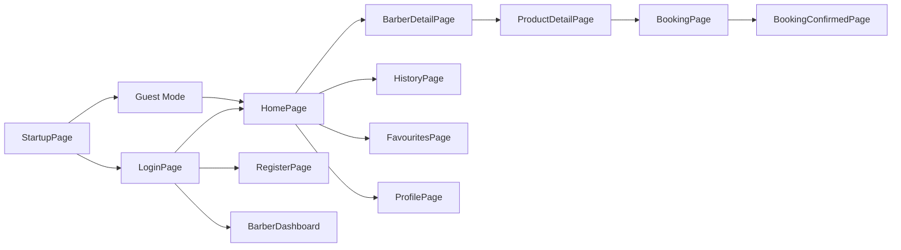

# Cut & Click — Filguide 🧠

> asså bror, här e hela kodbasen förklarad typ så du fattar vad varje fil gör no cap

---

## 🖥️ Server

### Kärnan

| Fil | Vad den gör |
|-----|-------------|
| [app.js](file:///c:/Users/mahdm/Desktop/CutAndClick/server/app.js) | express-appen bro, allt sätts ihop här — middleware, cors, rate limiting, routes. den e typ hjärtat av backend |
| [server.js](file:///c:/Users/mahdm/Desktop/CutAndClick/server/server.js) | startar servern på rätt port, kollar att databasen lever innan allt drar igång |
| [config/db.js](file:///c:/Users/mahdm/Desktop/CutAndClick/server/config/db.js) | kopplar upp supabase-klienten med service role key, den här klienten har admin-access type shit |

**motivering:** [app.js](file:///c:/Users/mahdm/Desktop/CutAndClick/server/app.js) e master-filen som kopplar ihop allt. utan den snurrar ingenting. [server.js](file:///c:/Users/mahdm/Desktop/CutAndClick/server/server.js) e ba den som kör igång allt. [db.js](file:///c:/Users/mahdm/Desktop/CutAndClick/server/config/db.js) ger dig databasen, utan den kan du inte prata med supabase överhuvudtaget ykwim

---

### Controllers

det här e hjärnorna bror, all logik sitter här

| Fil | Vad den gör |
|-----|-------------|
| [authController.js](file:///c:/Users/mahdm/Desktop/CutAndClick/server/controllers/authController.js) | hanterar allt med användare — register, login, logout, profil, oauth-sync. den skapar temp supabase-klienter för auth så det inte bugar med admin-klienten |
| [barberController.js](file:///c:/Users/mahdm/Desktop/CutAndClick/server/controllers/barberController.js) | hämtar barbers — alla, sök, nära dig, specifik med allt (tjänster, produkter, öppettider). har en helper som formaterar barber-datan snyggt |
| [bookingController.js](file:///c:/Users/mahdm/Desktop/CutAndClick/server/controllers/bookingController.js) | bokningar mannen — lediga tider, skapa bokning, avboka, hämta dina/barberns bokningar. räknar ut slots baserat på öppettider och existerande bokningar |
| [favouriteController.js](file:///c:/Users/mahdm/Desktop/CutAndClick/server/controllers/favouriteController.js) | favoriter yani, visa/lägga till/ta bort barbers från dina favs |
| [notificationController.js](file:///c:/Users/mahdm/Desktop/CutAndClick/server/controllers/notificationController.js) | in-app notiser — hämta, markera läst, markera alla lästa. plus en helper för att skapa nya notiser |
| [openingHoursController.js](file:///c:/Users/mahdm/Desktop/CutAndClick/server/controllers/openingHoursController.js) | öppettider type shit — visa för en barber, eller uppdatera som barber |
| [postController.js](file:///c:/Users/mahdm/Desktop/CutAndClick/server/controllers/postController.js) | hanterar klippningar och produkter — crud (skapa, uppdatera, ta bort, toggla aktiv/inaktiv). har en helper som kollar att du äger grejen innan du rör den |
| [reviewController.js](file:///c:/Users/mahdm/Desktop/CutAndClick/server/controllers/reviewController.js) | reviews/omdömen — visa för en barber, skapa nytt. kollar att du faktiskt bokat hos barbern innan du kan lämna review |

**motivering:** varje controller e ansvarig för sin grej. auth hanterar allt med konton, booking allt med bokningar osv. det håller koden clean och man vet var man ska kolla om ngt bugar fr fr

---

### Middleware

| Fil | Vad den gör |
|-----|-------------|
| [authMiddleware.js](file:///c:/Users/mahdm/Desktop/CutAndClick/server/middleware/authMiddleware.js) | tre dörrvakter: [protect](file:///c:/Users/mahdm/Desktop/CutAndClick/server/middleware/authMiddleware.js#3-22) (kräver token), [requireBarber](file:///c:/Users/mahdm/Desktop/CutAndClick/server/middleware/authMiddleware.js#23-55) (kräver barber-roll), [optionalProtect](file:///c:/Users/mahdm/Desktop/CutAndClick/server/middleware/authMiddleware.js#56-69) (tar token om den finns men kraschar inte utan) |
| [validate.js](file:///c:/Users/mahdm/Desktop/CutAndClick/server/middleware/validate.js) | validerar input med express-validator — register, booking, review, haircut. skickar tillbaka snygga felmeddelanden om ngt e fel |

**motivering:** middleware sitter mellan request och controller. [protect](file:///c:/Users/mahdm/Desktop/CutAndClick/server/middleware/authMiddleware.js#3-22) kollar att du e inloggad, [requireBarber](file:///c:/Users/mahdm/Desktop/CutAndClick/server/middleware/authMiddleware.js#23-55) att du e barber. [validate](file:///c:/Users/mahdm/Desktop/CutAndClick/client/src/pages/RegisterPage.tsx#52-74) ser till att folk inte skickar in skräp-data

---

### Routes

rutter mappar URL:er till controllers, inte så mycket logik här

| Fil | Vad den gör |
|-----|-------------|
| [authRoutes.js](file:///c:/Users/mahdm/Desktop/CutAndClick/server/routes/authRoutes.js) | `/api/auth/*` — register, login, logout, profil, oauth-sync |
| [barberRoutes.js](file:///c:/Users/mahdm/Desktop/CutAndClick/server/routes/barberRoutes.js) | `/api/barbers/*` — alla barbers, sök, nära, specifik. specifika routes ligger FÖRE `:id` annars bugar express |
| [bookingRoutes.js](file:///c:/Users/mahdm/Desktop/CutAndClick/server/routes/bookingRoutes.js) | `/api/bookings/*` — lediga tider, mina bokningar, barber-bokningar, skapa, avboka |
| [favouriteRoutes.js](file:///c:/Users/mahdm/Desktop/CutAndClick/server/routes/favouriteRoutes.js) | `/api/favourites/*` — hämta, lägga till, ta bort favorit |
| [notificationRoutes.js](file:///c:/Users/mahdm/Desktop/CutAndClick/server/routes/notificationRoutes.js) | `/api/notifications/*` — hämta, markera läst, markera alla |
| [openingHoursRoutes.js](file:///c:/Users/mahdm/Desktop/CutAndClick/server/routes/openingHoursRoutes.js) | `/api/opening-hours/*` — visa/uppdatera öppettider |
| [postRoutes.js](file:///c:/Users/mahdm/Desktop/CutAndClick/server/routes/postRoutes.js) | `/api/posts/*` — haircuts + items, crud, toggla, markera bokning klar |
| [reviewRoutes.js](file:///c:/Users/mahdm/Desktop/CutAndClick/server/routes/reviewRoutes.js) | `/api/reviews/*` — hämta reviews, skapa review |

---

### Utils

| Fil | Vad den gör |
|-----|-------------|
| [emailService.js](file:///c:/Users/mahdm/Desktop/CutAndClick/server/utils/emailService.js) | skickar mejl via resend — bokningsbekräftelse och påminnelse. om resend inte e konfigurerat kraschar den inte, den loggar ba och fortsätter |

---

## 💻 Client

### Kärnan

| Fil | Vad den gör |
|-----|-------------|
| [index.tsx](file:///c:/Users/mahdm/Desktop/CutAndClick/client/src/index.tsx) | entry point — mountar React-appen i DOM:en, wrappar med ErrorBoundary |
| [App.tsx](file:///c:/Users/mahdm/Desktop/CutAndClick/client/src/App.tsx) | BOSSEN av frontend. hanterar all navigation (screen-state), guest guard, tabs, sidebar, bottom nav. allt routas härifrån typ |
| [supabase.ts](file:///c:/Users/mahdm/Desktop/CutAndClick/client/src/supabase.ts) | skapar supabase-klienten för frontend med anon key |
| [types.ts](file:///c:/Users/mahdm/Desktop/CutAndClick/client/src/types.ts) | alla TypeScript-interfaces — BarberShop, Service, Product, Booking, OpeningHour osv |

**motivering:** [App.tsx](file:///c:/Users/mahdm/Desktop/CutAndClick/client/src/App.tsx) e den viktigaste filen i hela frontend. den styr vilken sida du ser, om du e inloggad/gäst, och kopplar ihop allt. om ngt e rörigt med navigation — börja här

---

### Context

| Fil | Vad den gör |
|-----|-------------|
| [AuthContext.tsx](file:///c:/Users/mahdm/Desktop/CutAndClick/client/src/context/AuthContext.tsx) | global auth-state — user, token, login/logout/guest. sparar session i localStorage och lyssnar på supabase oauth events. alla komponenter kan komma åt usern via [useAuth()](file:///c:/Users/mahdm/Desktop/CutAndClick/client/src/context/AuthContext.tsx#136-142) |
| [FavouritesContext.tsx](file:///c:/Users/mahdm/Desktop/CutAndClick/client/src/context/FavouritesContext.tsx) | global favorit-state — hämtar dina favs, toggle med optimistic update (UI uppdateras direkt, revertar om API smäller) |

**motivering:** context e typ globala variabler i react. istället för att skicka `user` till varje komponent via props har du [useAuth()](file:///c:/Users/mahdm/Desktop/CutAndClick/client/src/context/AuthContext.tsx#136-142) som alla kan använda direkt ykwim

---

### Pages

| Fil | Vad den gör |
|-----|-------------|
| [StartupPage.tsx](file:///c:/Users/mahdm/Desktop/CutAndClick/client/src/pages/StartupPage.tsx) | splash/welcome screen, det första man ser. kan gå vidare som gäst eller logga in |
| [LoginPage.tsx](file:///c:/Users/mahdm/Desktop/CutAndClick/client/src/pages/LoginPage.tsx) | login med email/lösen eller google/apple oauth. snygga animationer med framer motion |
| [RegisterPage.tsx](file:///c:/Users/mahdm/Desktop/CutAndClick/client/src/pages/RegisterPage.tsx) | tvåstegs-registrering — först välj roll (kund/barber), sen fyll i formulär. barbers fyller i extra grejer som salong, adress, telefon, karta |
| [HomePage.tsx](file:///c:/Users/mahdm/Desktop/CutAndClick/client/src/pages/HomePage.tsx) | huvudsidan med barber-kort, sök, filter (populärast/nära/nyast), notifikationer. caching i sessionStorage 5 min |
| [BarberDetailPage.tsx](file:///c:/Users/mahdm/Desktop/CutAndClick/client/src/pages/BarberDetailPage.tsx) | detaljsida för en barber — hero-bild, kontaktinfo, action-knappar (ring/whatsapp/karta/dela), tabs (allt/tjänster/produkter/info), öppettider, embedded karta |
| [BookingPage.tsx](file:///c:/Users/mahdm/Desktop/CutAndClick/client/src/pages/BookingPage.tsx) | kalender + tidsslots. välj datum → hämtar lediga tider → välj tid → boka |
| [BookingConfirmedPage.tsx](file:///c:/Users/mahdm/Desktop/CutAndClick/client/src/pages/BookingConfirmedPage.tsx) | bekräftelsesida efter bokning med detaljer |
| [ProductDetailPage.tsx](file:///c:/Users/mahdm/Desktop/CutAndClick/client/src/pages/ProductDetailPage.tsx) | detaljvy för en tjänst/produkt med bild, pris, beskrivning, boka-knapp |
| [StoreServicesPage.tsx](file:///c:/Users/mahdm/Desktop/CutAndClick/client/src/pages/StoreServicesPage.tsx) | "se alla" tjänster/produkter för en barber |
| [HistoryPage.tsx](file:///c:/Users/mahdm/Desktop/CutAndClick/client/src/pages/HistoryPage.tsx) | bokningshistorik — kommande vs gammalt. kan avboka kommande, lämna omdöme för utförda |
| [FavouritesPage.tsx](file:///c:/Users/mahdm/Desktop/CutAndClick/client/src/pages/FavouritesPage.tsx) | sparade favoriter med swipe-to-remove, sortering, klickbar till barber-detalj |
| [ProfilePage.tsx](file:///c:/Users/mahdm/Desktop/CutAndClick/client/src/pages/ProfilePage.tsx) | profil med stats, profilbild-upload, byt namn/stad, notis-inställningar, byt lösenord |
| [BarberDashboardPage.tsx](file:///c:/Users/mahdm/Desktop/CutAndClick/client/src/pages/BarberDashboardPage.tsx) | dashboard för barbers med sidebar och sub-pages |

---

### Barber Sub-Pages

| Fil | Vad den gör |
|-----|-------------|
| [BarberHomePage.tsx](file:///c:/Users/mahdm/Desktop/CutAndClick/client/src/pages/barber/BarberHomePage.tsx) | hem-vy för barber — stats, senaste bokningar |
| [BarberBookingsPage.tsx](file:///c:/Users/mahdm/Desktop/CutAndClick/client/src/pages/barber/BarberBookingsPage.tsx) | hanterar barbers bokningar — se, markera utförd |
| [BarberServicesPage.tsx](file:///c:/Users/mahdm/Desktop/CutAndClick/client/src/pages/barber/BarberServicesPage.tsx) | hantera klippningar — skapa, redigera, toggla |
| [BarberProductsPage.tsx](file:///c:/Users/mahdm/Desktop/CutAndClick/client/src/pages/barber/BarberProductsPage.tsx) | hantera produkter — skapa, redigera, toggla |
| [BarberSchedulePage.tsx](file:///c:/Users/mahdm/Desktop/CutAndClick/client/src/pages/barber/BarberSchedulePage.tsx) | ställ in öppettider per dag |
| [BarberSettingsPage.tsx](file:///c:/Users/mahdm/Desktop/CutAndClick/client/src/pages/barber/BarberSettingsPage.tsx) | barber-inställningar — profil, salong-info, cover-bild |

---

### Components

| Fil | Vad den gör |
|-----|-------------|
| [BarberCard.tsx](file:///c:/Users/mahdm/Desktop/CutAndClick/client/src/components/BarberCard.tsx) | kort som visar en barber — bild, namn, stad, rating, favorit-hjärta. används på HomePage |
| [ProductCard.tsx](file:///c:/Users/mahdm/Desktop/CutAndClick/client/src/components/ProductCard.tsx) | kort för produkt/tjänst med glassmorphism-effekt och prisinfo |
| [StoreItemCard.tsx](file:///c:/Users/mahdm/Desktop/CutAndClick/client/src/components/StoreItemCard.tsx) | liknande produktkort med shimmer-effekt, används i StoreServicesPage |
| [ReviewModal.tsx](file:///c:/Users/mahdm/Desktop/CutAndClick/client/src/components/ReviewModal.tsx) | modal för att lämna omdöme — stjärnbetyg, rubrik, beskrivning |
| [NotificationsPanel.tsx](file:///c:/Users/mahdm/Desktop/CutAndClick/client/src/components/NotificationsPanel.tsx) | slide-in panel från höger med notiser, markera läst/alla |
| [ErrorBoundary.tsx](file:///c:/Users/mahdm/Desktop/CutAndClick/client/src/components/ErrorBoundary.tsx) | fångar oväntade React-kraschar och visar "nåt gick fel"-sida |
| [Toast.tsx](file:///c:/Users/mahdm/Desktop/CutAndClick/client/src/components/ui/Toast.tsx) | liten popup nere till höger med meddelanden |

---

### Common Components

| Fil | Vad den gör |
|-----|-------------|
| [AddressAutocomplete.tsx](file:///c:/Users/mahdm/Desktop/CutAndClick/client/src/components/common/AddressAutocomplete.tsx) | autocomplete för adresser vid registrering |
| [ImageUpload.tsx](file:///c:/Users/mahdm/Desktop/CutAndClick/client/src/components/common/ImageUpload.tsx) | ladda upp bild till supabase storage |
| [LocationPickerMap.tsx](file:///c:/Users/mahdm/Desktop/CutAndClick/client/src/components/common/LocationPickerMap.tsx) | interaktiv karta för att välja plats |
| [PhoneInput.tsx](file:///c:/Users/mahdm/Desktop/CutAndClick/client/src/components/common/PhoneInput.tsx) | telefoninput med landskod och validering |
| [RegisterImagePicker.tsx](file:///c:/Users/mahdm/Desktop/CutAndClick/client/src/components/common/RegisterImagePicker.tsx) | välja profilbild vid registrering |
| [WebsiteInput.tsx](file:///c:/Users/mahdm/Desktop/CutAndClick/client/src/components/common/WebsiteInput.tsx) | webbadress-input med validering |

---

## Flödet i ett nötskal 🥜

> wallah bror nu vet du vad varje fil gör i hela kodbasen 💪
